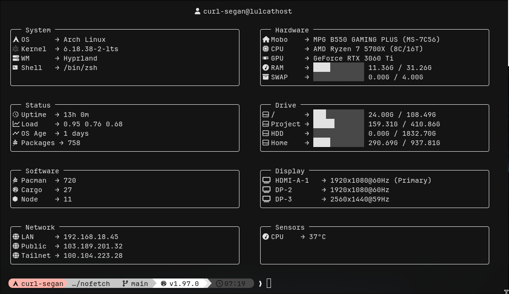
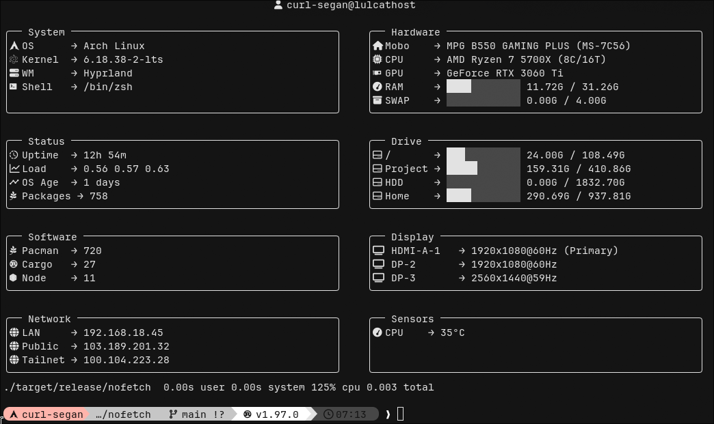
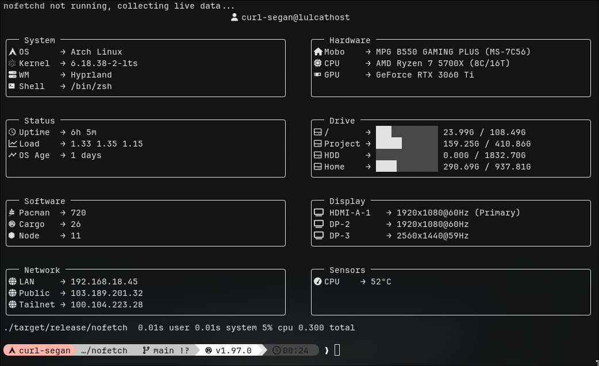

# nofetch

> Dashboard-first system information for modern terminals.

Unlike traditional fetch utilities, **nofetch doesn't fetch anything**.

System information is collected ahead of time by **`nofetchd`**, allowing `nofetch` to instantly render a cached system snapshot.



---

## Why?

Traditional fetch utilities collect information every time you run them.

```
Run
 ├─ Read /proc
 ├─ Read /sys
 ├─ Spawn processes
 ├─ Query optional services
 └─ Render
```

As more modules are enabled, startup time naturally increases.

`nofetch` separates **collection** from **rendering**.

```
             Background
          ┌───────────────┐
          │   nofetchd    │
          ├───────────────┤
          │ Collectors    │
          │ Cache         │
          └──────┬────────┘
                 │
            Unix Socket
                 │
          ┌──────▼────────┐
          │    nofetch    │
          └───────────────┘
```

`nofetchd` continuously collects and caches system information.

`nofetch` simply renders the latest snapshot.

### Why a daemon?

Running a background daemon isn't free.

It consumes a small amount of memory and periodically refreshes cached data.

In return, you get:

- Consistent startup time
- Native collectors without spawning dozens of shell commands
- Support for slower collectors such as Docker, Tailscale, or Public IP
- A clean separation between data collection and rendering

This tradeoff is intentional.

If you prefer collecting everything on demand, Fastfetch is an excellent choice.

`nofetch` simply explores a different architecture.

| With daemon (0.003s) | Without daemon (0.30s) |
|----------------------|------------------------|
|  |  |

---

## Features

- Dashboard-style card layout
- Responsive multi-column layouts
- Background collectors
- Native Linux collectors (`/proc`, `/sys`, syscalls)
- Automatic collector discovery
- Progress bars
- Theme support
- Linux-first

Collectors are automatically enabled when available.

For example:

- Docker socket → Docker collector
- `tailscaled` → Tailscale collector
- NVIDIA driver → NVIDIA collector

No manual configuration required.

---

## Layout Engine

Unlike traditional fetch utilities, `nofetch` renders **cards**, not sequential modules.

```
┌── System ──────────────┐ ┌── Hardware ───────────┐
│ Arch Linux             │ │ Ryzen 7 5700X         │
│ Linux 6.18             │ │ RTX 3060 Ti           │
│ 2h 31m uptime          │ │ ████░░ 9 / 32 GiB     │
└────────────────────────┘ └───────────────────────┘

┌── Software ────────────┐ ┌── Network ────────────┐
│ Rust 1.97              │ │ LAN                   │
│ Cargo                  │ │ Tailnet               │
└────────────────────────┘ └───────────────────────┘
```

The dashboard automatically adapts to your terminal width.

```
Small
System
Hardware
Display

Medium
System      Hardware
Display     Network

Wide
System   Hardware   Display
Software Network    Sensors
```

---

## Philosophy

`nofetch` is intentionally opinionated.

It is **not** a Fastfetch replacement.

It is **not** trying to support every operating system.

It is built primarily for modern Linux desktops and power users.

---

## Roadmap

### v0.1

- [x] Layout engine
- [x] Card renderer
- [x] Linux collectors
- [x] Unix socket protocol
- [x] Snapshot cache

### v0.2

- [ ] Docker collector
- [ ] Podman collector
- [ ] Tailscale collector
- [ ] Battery collector
- [ ] Sensor improvements

### v0.3

- [ ] Themes
- [ ] TOML layouts
- [ ] Plugin API
- [ ] JSON output

### v1.0

- [ ] Stable collector API
- [ ] Adaptive layouts
- [ ] Public plugin ecosystem

---

## Building

```bash
cargo build --release

cargo run -p nofetchd

cargo run -p nofetch
```

---

## FAQ

### Why is it called "nofetch"?

Because it doesn't fetch anything.

`nofetchd` already did.

### Does it replace Fastfetch?

No.

Fastfetch is an excellent system information tool.

`nofetch` explores a different architecture centered around dashboard layouts and cached system snapshots.

---

## License

GPL-3.0
