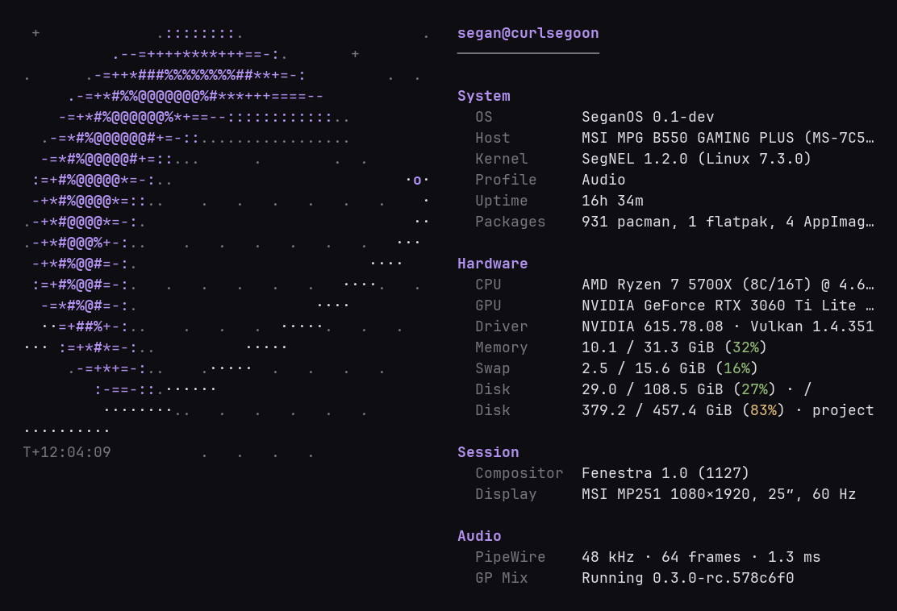
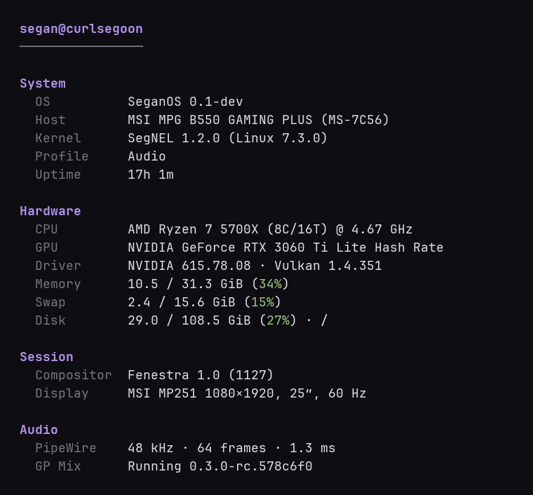
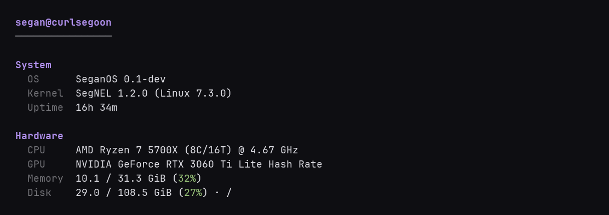
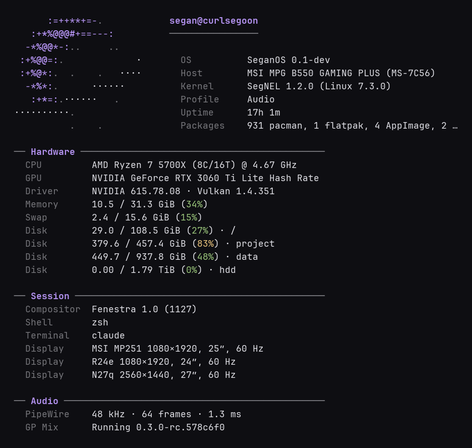

# Census

The fetch tool that already counted.

A daemon, `censusd`, collects your system's facts ahead of time. `census` asks it over a Unix socket and prints the answer in about a millisecond. On SeganOS it also knows the kernel profile, the audio latency and the compositor; everywhere else it shows what is there.



## What it prints

A logo on the left and an aligned list on the right, in four groups: System, Hardware, Session, Audio. Labels are dim, values are your terminal's own foreground, and one accent (your theme's magenta) marks the logo and the section names. No boxes, no bars.

On a narrow terminal the logo goes; on a short one the least important lines go.

| Narrow | Short |
|---|---|
|  |  |

`census --layout compact` puts a small logo above a list with thin rules between the groups:



`census --layout dashboard` is the older card layout.

## SeganOS

Each of these shows only when it is there, and none of them starts a process per render; the daemon reads them on its own schedule.

- **OS**: `SeganOS <version>` from `/etc/seganos-release`.
- **Kernel**: `Nox <version> (Linux <version>)` when the running kernel is Nox, and the kerneld profile (Balanced, Audio, Game, Performance) from kerneld's socket, or `/var/lib/segan-kerneld/mode`.
- **Compositor**: the Fenestra version from `fenestractl`; on other desktops, `XDG_CURRENT_DESKTOP`.
- **GPU**: name, driver and version, Vulkan API version.
- **Audio**: PipeWire's clock rate and quantum as latency in milliseconds, read with `pw-metadata`.
- **GP Mix**: running or not, and its version.

Elsewhere the logo is a neutral mark; on SeganOS it is the Eclipse, drawn at run time to the height of the list (14 to 40 rows) and to your terminal's cell shape, so the disc is round whatever the font. Terminals that report their size in pixels need no setting; for the rest, or when the terminal gets it wrong, set `cell_aspect` (a cell's height over its width, about 2.0 to 2.8) under `[layout]`, or `CENSUS_CELL_ASPECT` in the environment. The drawn art is cached under `~/.cache/census/`.

Removable media (USB sticks, SD cards) are not listed as disks unless `[layout] removable_disks = true`.

## Private by default

Census prints nothing about your network unless you ask. Edit `~/.config/census/config.toml`:

```toml
[privacy]
lan_ip = true
public_ip = false   # asks an outside service, once per refresh
tailnet_ip = false
```

## Options

```
census [--layout classic|compact|dashboard] [--logo auto|eclipse|neutral|none]
       [--width N] [--height N] [--color auto|always|never]
       [--json] [--snapshot FILE]
```

`--json` prints the snapshot; `--snapshot` renders a saved one.

Config lives in `~/.config/census/config.toml`: `[layout]` (`style`, `logo`, `sections`, `cell_aspect`, `removable_disks`), `[privacy]`, `[daemon]` (`socket_path`, `collector_interval_secs`).

## Why a daemon

Fetch tools collect on every run. Census separates collection from rendering: `censusd` keeps a snapshot warm, `census` reads it. Without the daemon, `census` collects directly, prints a one-line hint, and takes a few tens of milliseconds.

```
            Background
        ┌────────────────┐
        │    censusd     │
        └───────┬────────┘
           Unix socket
        ┌───────▼────────┐
        │     census     │
        └────────────────┘
```

## Install

```bash
cargo install --path crates/census
cargo install --path crates/censusd
mkdir -p ~/.config/systemd/user
cp contrib/censusd.service ~/.config/systemd/user/
systemctl --user daemon-reload
systemctl --user enable --now censusd
```

## Building

```bash
cargo build --release
cargo test
tools/bench.sh            # census (warm daemon) against fastfetch
```

`tools/ansi2png.py` and `tools/shots.sh` make the screenshots. The Eclipse is drawn by `crates/census-render/src/eclipse.rs` from geometry (every length a ratio of the disc radius), with a tone per cell: `b` the bold core of the crescent, `a` accent, `d` the dim disc and stars, `f` the terminal's own foreground for the orbit. Tune the ratios there; `ART_VERSION` invalidates the cache.

## Roadmap

- `census --card`: a PNG card of your setup for sharing.
- Each distro's own logo.
- Docker and Tailscale lines (their collectors exist but are not wired in yet), battery.

## License

AGPL-3.0-only
